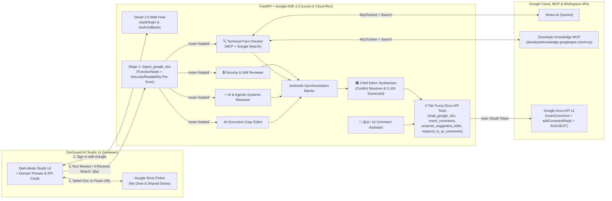

# 🛡️ DocGuard AI Studio — Autonomous Google Docs Reviewer, Security Auditor & 4-Persona ADK 2.0 Graph Workflow

**Author:** [Robina Mirbahar](https://github.com/RobinaMirbahar) — Google Cloud & AI Architect | Google Developer Expert (AI & Cloud)

[](https://cloud.google.com/run)
[](https://google.github.io/adk-docs/)
[](https://developerknowledge.googleapis.com/mcp)
[](https://opensource.org/licenses/Apache-2.0)

**DocGuard AI Studio** is a standalone, production-grade **Google Docs Technical Reviewer, Security Pre-Scanner, and 4-Persona Virtual Review Board** built on **Google ADK 2.0 (`Workflow`, `FunctionNode`, `RoutingMap`, `JoinNode`)**, **Gemini on Vertex AI**, **Google Developer Knowledge Remote MCP Server**, **Google Search Grounding**, **Google Drive Picker**, and the **Google Docs API v1 (`insertComment`, `addCommentReply`, and `writeControl: {"writeMode": "SUGGEST"}`)**.

---

## ✨ What Makes DocGuard AI Studio Stand Out

1. **🏛️ 4-Persona ADK 2.0 Graph Workflow (`app/addons/review_board.py`)**
   - Uses a zero-LLM Python `FunctionNode` (`ingest_google_doc`) to ingest the Google Doc once and compute deterministic readability & security pre-diagnostics before fanning out in parallel to **four specialist agents**:
     1. **🔒 Security & Cloud Architecture Reviewer** — Audits exposed secrets, primitive IAM roles (`roles/owner`, `roles/editor`, `allUsers`), and reliability single points of failure.
     2. **🔍 Technical Fact-Checker & Citation Verifier** — Verifies Google Cloud, Gemini, Gemma, ADK, Firebase, Android, Chrome, Flutter, and Go claims against the **Google Developer Knowledge MCP Server** (`https://developerknowledge.googleapis.com/mcp`) and general facts via **Google Search Grounding**.
     3. **🤖 AI & Agentic Systems Reviewer** — Audits prompt engineering, structured Pydantic schemas, `adk eval` evaluation pipelines, Model Armor guardrails, OpenTelemetry `gen_ai.*` tracing, and hybrid Gemini + Gemma Multi-LoRA serving patterns.
     4. **✍️ Executive Copy Editor & Clarity Specialist** — Tightens bloated/passive prose, fixes grammar/typos, and improves executive readability.
   - Synchronizes all 4 branches at a `JoinNode` barrier and fans into the **🏛️ Chief Editor Synthesizer**, which resolves overlapping edit ranges (`Security > Fact-Check > AI Systems > Copy Edit`), attaches persona-badged comments, submits inline Suggested Edits, and generates a **0–100 Document Readiness Scorecard**.

2. **🎯 4-Tier Resilient Fuzzy Range Matcher (`app/tools.py`)**
   - Standard substring matchers frequently skip comments or suggested edits when Google Docs converts straight quotes (`"`, `'`) to smart curly quotes (`“`, `”`, `’`), inserts non-breaking spaces (`\u00a0`), or when an LLM slightly normalizes whitespace.
   - DocGuard's `_find_doc_range()` uses a **4-tier matching engine**:
     1. Exact verbatim substring match.
     2. Smart-quote, em-dash, and non-breaking-space normalized match (preserving 1:1 Docs API character indices).
     3. Whitespace-tolerant regex matching within single-paragraph boundaries.
     4. `difflib.SequenceMatcher` longest-contiguous-block fuzzy fallback (≥88% similarity) with strict newline boundary protection so `deleteContentRange` never corrupts paragraph styling.

3. **🛡️ Deterministic Security & Readability Pre-Scanner (`compute_document_diagnostics`)**
   - Automatically scans every loaded Google Doc with zero token cost for:
     - Exposed Google API keys (`AIza...`), Google OAuth Client Secrets (`GOCSPX-...`), GitHub PATs (`ghp_...`, `gho_...`), and PEM private keys.
     - Overly permissive IAM bindings (`roles/owner`, `roles/editor`, `allUsers`, `allAuthenticatedUsers`).
     - Word count, sentence count, paragraph count, estimated reading time, and **Flesch Reading Ease** score.

4. **🎛️ Domain Review Presets + Dark-Mode Studio UI + Markdown Report Export (`app/fast_api_app.py`)**
   - Built-in one-click presets for:
     - **Default Technical & Editorial Review**
     - **Google Cloud Architecture RFC & Security Audit**
     - **AI & Agentic Systems Engineering Spec (ADK / Gemini / Gemma)**
     - **Executive Strategy Brief & Board Memo**
   - Accepts either a **full Google Docs URL** (`https://docs.google.com/document/d/.../edit`) or a raw Document ID, displays live KPI cards (Word Count, Flesch Readability, Security Alerts, Anchored Comments, Suggested Edits), and includes one-click **`.md` Audit Report download**.

5. **💬 Interactive `@ai` and `/ai` In-Document Comment Assistant (`app/addons/ai_comments.py`)**
   - Highlight any sentence or code block inside Google Docs and leave a comment starting with `@ai` or `/ai` (e.g., `@ai verify this Cloud Run GPU quota and rewrite`). DocGuard resolves the exact `CommentAnchor` range, proposes an inline Suggested Edit (`writeMode: "SUGGEST"`), and replies directly inside your comment thread (`addCommentReply`).

6. **⚡ Lazy ADC & Offline-Safe Telemetry Initialization (`app/agent.py` & `app/fast_api_app.py`)**
   - Resolves Developer Knowledge MCP headers lazily at request time via `header_provider` and gracefully falls back when local Application Default Credentials (ADC) are absent during CI/CD unit testing.

---

## 🏗️ Architecture Overview



---

## 📂 Project Structure

```text
docguard-ai-studio/
├── app/
│   ├── agent.py               # Core ADK Root Agent (Grounded Reviewer + Lazy MCP Header Provider)
│   ├── tools.py               # 4-Tier Fuzzy Range Matcher, Security/Readability Diagnostics & Docs API v1 tools
│   ├── addons/
│   │   ├── ai_comments.py     # Interactive @ai / /ai Comment-to-Suggested-Edit Assistant
│   │   └── review_board.py    # 4-Persona ADK 2.0 Graph Workflow (Security, Fact-Check, AI Systems, Copy Editor + Chief Editor)
│   ├── fast_api_app.py        # FastAPI server, Domain Presets, OAuth 2.0, Drive Picker & Dark-Mode Studio UI
│   └── app_utils/             # ADK Runner, A2A protocol routes, and Cloud Trace telemetry helpers
├── tests/
│   ├── unit/test_dummy.py     # Unit tests for 4-tier fuzzy matching, secret pre-scanner, URL parsing & 4-persona board
│   └── integration/           # Agent streaming and E2E server tests
├── .env.example               # Template for local and Cloud Run environment variables
├── deploy.sh                  # Automated one-command Google Cloud Run deployment script
├── Dockerfile                 # Production container image using Python 3.12 and uv
└── pyproject.toml             # Python dependencies managed by uv
```

---

## 🚀 Quickstart (Local & Google Cloud Shell)

### 1. Clone and Configure `.env`

```bash
git clone https://github.com/RobinaMirbahar/docguard-ai-studio.git
cd docguard-ai-studio
cp .env.example .env
```

Fill in `.env` with your Google Cloud Project ID (`GOOGLE_CLOUD_PROJECT`), Project Number (`GOOGLE_CLOUD_PROJECT_NUMBER`), OAuth 2.0 Web Client credentials (`OAUTH_CLIENT_ID`, `OAUTH_CLIENT_SECRET`), and Browser Picker API key (`GOOGLE_PICKER_API_KEY`).

### 2. Run Unit Tests

```bash
uv run pytest tests/unit/test_dummy.py -v
```

### 3. Run Locally

```bash
uv run uvicorn app.fast_api_app:app --host 127.0.0.1 --port 8000 --reload
```

Open **http://localhost:8000/reviewer** in your browser.

### 4. Deploy to Google Cloud Run (One Command)

```bash
chmod +x deploy.sh
./deploy.sh
```

`deploy.sh` automatically enables Vertex AI, Developer Knowledge MCP, Google Docs, Drive, Picker, Cloud Build, and Cloud Run APIs, provisions the least-privilege runtime service account, and deploys the container to Cloud Run.

---

## 👩‍💻 Author

**Robina Mirbahar**  
Google Cloud & AI Architect | Google Developer Expert (AI & Cloud) | Women Techmakers Ambassador  
- GitHub: [@RobinaMirbahar](https://github.com/RobinaMirbahar)
